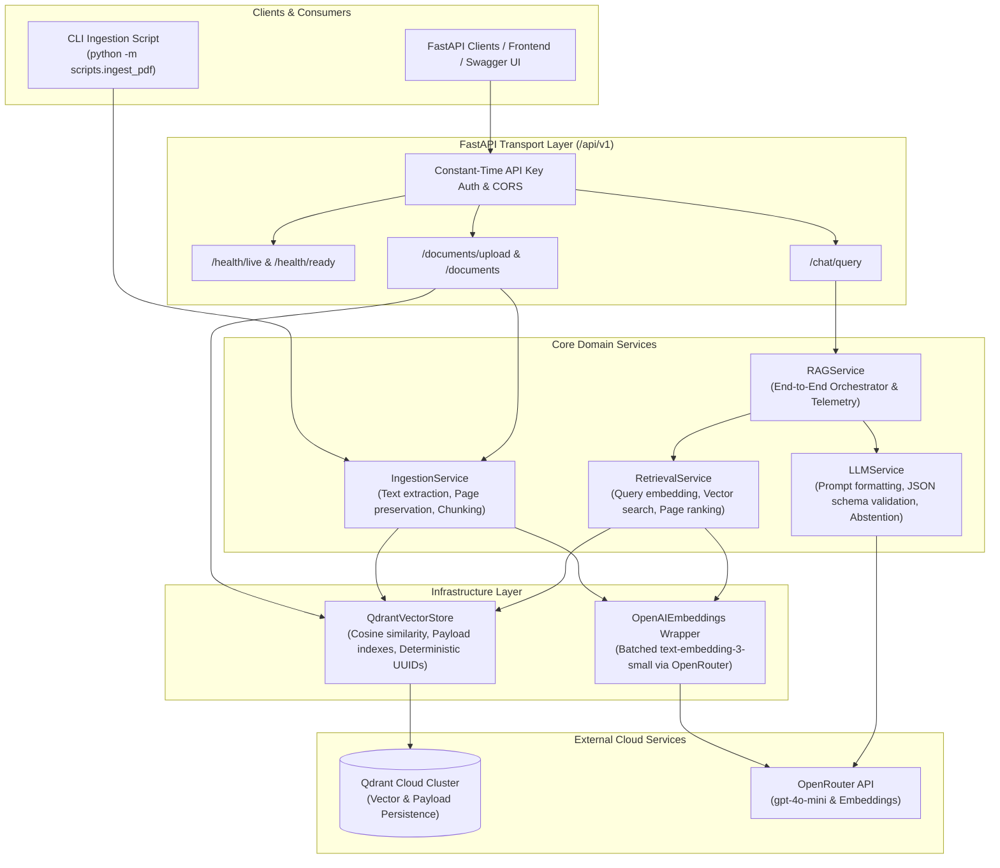

# ExamRAG — Production-Minded RAG API

> **ExamRAG** is a production-grade, document-grounded question-answering API engineered to generate structured, examination-ready answers for B.Tech Computer Science students. Powered by **FastAPI**, **Qdrant Cloud**, **LangChain**, and **OpenRouter**, it converts academic textbook PDFs into grounded, verifiable answers with precise page-level citations.

---

## 1. Architectural Overview

ExamRAG follows clean architectural boundaries separating API transport, domain services, infrastructure persistence, and evaluation:



---

## 2. Directory Structure

```text
examrag/
├── app/
│   ├── __init__.py
│   ├── main.py                     # FastAPI application factory, lifespan, CORS, and error handlers
│   ├── core/
│   │   ├── __init__.py
│   │   ├── config.py               # Typed Pydantic Settings and production startup validation
│   │   ├── exceptions.py           # Domain exceptions (InvalidPDF, DimensionMismatch, Abstention, etc.)
│   │   └── logging.py              # Structured logging with sensitive key and token redaction
│   ├── api/
│   │   ├── __init__.py
│   │   ├── dependencies.py         # Ingestion API key verification and service injection
│   │   ├── routes/
│   │   │   ├── __init__.py
│   │   │   ├── health.py           # Liveness (/health/live) & Readiness (/health/ready) probes
│   │   │   ├── documents.py        # PDF upload, ingestion, document listing, and point deletion
│   │   │   └── chat.py             # Exam-ready Q&A query endpoint with source citations
│   │   └── schemas/
│   │       ├── __init__.py
│   │       ├── common.py           # Standard health, ready, error, and deletion schemas
│   │       ├── document.py         # Ingestion summaries, path requests, and document details
│   │       └── chat.py             # ChatRequest, ChatResponse, ExamAnswer, and SourceChunk schemas
│   ├── services/
│   │   ├── __init__.py
│   │   ├── ingestion_service.py    # PDF parsing, text splitting, batch embedding, and Qdrant upsert
│   │   ├── retrieval_service.py    # Query embedding and Qdrant cosine similarity search
│   │   ├── llm_service.py          # Prompt assembly, structured JSON extraction, and abstention
│   │   └── rag_service.py          # Retrieval-to-generation orchestration and latency measurement
│   ├── infrastructure/
│   │   ├── __init__.py
│   │   ├── embeddings.py           # OpenRouter embeddings wrapper with dynamic dimension detection
│   │   └── vector_store.py         # Qdrant client, collection creation, indexing, and vector operations
│   └── prompts/
│       └── exam_answer.txt         # University exam answer prompt template (5-part academic structure)
├── documents/                      # Sample syllabus and test documents
├── scripts/
│   ├── __init__.py
│   └── ingest_pdf.py               # Reusable CLI ingestion tool
├── evaluation/
│   ├── __init__.py
│   ├── dataset.json                # Benchmark dataset with supported and unsupported exam queries
│   ├── evaluate.py                 # Retrieval quality (Recall@k, MRR), faithfulness, and latency evaluator
│   └── README.md                   # Evaluation methodology, metrics definitions, and execution guide
├── tests/
│   ├── __init__.py
│   ├── conftest.py                 # Pytest fixtures, mock vector stores, and test clients
│   ├── test_health.py              # Liveness and readiness dependency tests
│   ├── test_documents.py           # Upload validation, size limits, duplicate idempotency, deletion
│   ├── test_chat.py                # Chat answering, citations, timeout handling, and request validation
│   └── test_services.py            # Dimension mismatch, empty collection abstention, and metrics math
├── .env.example                    # Sample environment template
├── .gitignore                      # Git exclusion rules for virtualenvs, keys, and caches
├── Dockerfile                      # Production multi-stage Docker build with non-root user
├── .dockerignore                   # Docker exclusion rules
├── requirements.txt                # Pinned dependency requirements
├── pytest.ini                      # Pytest runner configuration
└── README.md                       # Comprehensive system documentation
```

---

## 3. Technology Stack

- **Python 3.11+**: Modern asynchronous backend.
- **FastAPI & Uvicorn**: High-performance RESTful API framework.
- **Pydantic v2 & pydantic-settings**: Strictly-typed configuration and validation.
- **Qdrant Cloud**: Persistent distributed vector store with Cosine distance indexing.
- **OpenRouter**: Unified LLM provider for `openai/gpt-4o-mini` and `text-embedding-3-small`.
- **LangChain (`langchain-openai`, `langchain-text-splitters`)**: OpenAI-compatible model interfaces.
- **pypdf**: Robust PDF text extraction preserving 1-indexed page boundaries.
- **pytest & HTTPX**: Automated test suite with isolated mocking.
- **Docker**: Containerized deployment for cloud hosts like Render.

---

## 4. Environment Configuration Reference

ExamRAG reads settings via `pydantic-settings` from environment variables or a local `.env` file.

| Variable | Default Value | Description |
| :--- | :--- | :--- |
| `APP_NAME` | `ExamRAG` | Name of the application |
| `APP_ENV` | `development` | Environment mode (`development`, `production`, `test`) |
| `API_V1_PREFIX` | `/api/v1` | URL prefix for REST routes |
| `LOG_LEVEL` | `INFO` | Logging level (`DEBUG`, `INFO`, `WARNING`, `ERROR`) |
| `OPENROUTER_API_KEY` | *(Required)* | OpenRouter secret API key |
| `OPENROUTER_BASE_URL` | `https://openrouter.ai/api/v1` | OpenRouter OpenAI-compatible endpoint |
| `CHAT_MODEL` | `openai/gpt-4o-mini` | Chat model identifier |
| `EMBEDDING_MODEL` | `text-embedding-3-small`| Embedding model identifier |
| `QDRANT_URL` | *(Required)* | Full HTTPS URL of your Qdrant Cloud cluster |
| `QDRANT_API_KEY` | *(Required)* | Qdrant Cloud access token |
| `QDRANT_COLLECTION_NAME` | `examrag_documents` | Collection name in Qdrant |
| `CHUNK_SIZE` | `500` | Chunk size in characters (must be > `CHUNK_OVERLAP`) |
| `CHUNK_OVERLAP` | `100` | Overlap between adjacent chunks in characters |
| `RETRIEVAL_TOP_K` | `3` | Default number of relevant chunks to retrieve |
| `RELEVANCE_THRESHOLD` | `None` | Optional cosine similarity cutoff (e.g., `0.70`) |
| `MAX_UPLOAD_SIZE_MB` | `20` | Maximum allowed PDF upload size in megabytes |
| `EMBEDDING_BATCH_SIZE` | `32` | Maximum chunk batch size for embedding calls |
| `LLM_TIMEOUT_SECONDS` | `45.0` | Timeout in seconds for LLM and embedding requests |
| `LLM_MAX_RETRIES` | `2` | Maximum retry attempts for transient network errors |
| `MAX_TOKENS` | `1000` | Maximum completion tokens requested from LLM |
| `CORS_ORIGINS` | `http://localhost:3000,...` | Comma-separated allowed web origins |
| `INGESTION_API_KEY` | *(Required)* | Secret key required for ingestion and deletion APIs |
| `PUBLIC_CHAT_ENABLED` | `true` | When `false`, chat endpoint requires `X-API-Key` |

> [!IMPORTANT]
> The vector dimension in Qdrant (e.g. 1536 for `text-embedding-3-small`) must match the selected embedding model. ExamRAG validates collection dimensions automatically upon startup and ingestion.

---

## 5. Prerequisites & Local Installation

### Prerequisites
- Python 3.11 or newer
- An [OpenRouter](https://openrouter.ai/) account with credits
- A [Qdrant Cloud](https://cloud.qdrant.io/) cluster

### Step 1: Clone the Repository and Create a Virtual Environment
```bash
git clone <repository-url>
cd "RAG Model for CAI"

python -m venv .venv
# Windows (PowerShell):
.venv\Scripts\Activate.ps1
# Linux / macOS:
source .venv/bin/activate
```

### Step 2: Install Dependencies
```bash
pip install -r requirements.txt
```

### Step 3: Configure Environment Variables
Copy `.env.example` to `.env`:
```bash
cp .env.example .env
```
Fill in your credentials:
```dotenv
OPENROUTER_API_KEY=sk-or-v1-your-key-here
QDRANT_URL=https://your-cluster-id.cloud.qdrant.io
QDRANT_API_KEY=your-qdrant-api-key-here
INGESTION_API_KEY=your-secure-ingestion-api-key-here
```

### Step 4: Run the FastAPI Server
```bash
uvicorn app.main:app --host 0.0.0.0 --port 8000 --reload
```
Open your browser to interactive documentation:
- Swagger UI: [http://localhost:8000/docs](http://localhost:8000/docs)
- ReDoc: [http://localhost:8000/redoc](http://localhost:8000/redoc)

---

## 6. Document Ingestion CLI

ExamRAG includes a reusable CLI script that utilizes the exact same ingestion service and validation logic as the REST API:

```bash
python -m scripts.ingest_pdf ./documents/Sample_Conversational_AI.pdf
```

### Example CLI Output:
```text
============================================================
ExamRAG Document Ingestion CLI
Target file: Sample_Conversational_AI.pdf
Collection:  examrag_documents
Embedding:   text-embedding-3-small
============================================================
Ingestion Summary:
  Status:       INDEXED
  Document ID:  doc_5ab3dd6ba9cd863b
  Filename:     Sample_Conversational_AI.pdf
  Page Count:   4
  Chunk Count:  7
  Content Hash: 5ab3dd6ba9cd863bf3c33002932cc052a40262b52b7851d6cc30f3f038cfe379
  Duration:     10.95 seconds
============================================================
Success: Document is indexed and ready for retrieval.
```

### Idempotency Behavior
Running the CLI on an already-indexed document detects the matching SHA-256 content hash and chunk count, skipping redundant embedding API calls:
```text
Document 'Sample_Conversational_AI.pdf' is already indexed with 7 chunks. Skipping duplicate embedding.
Status: ALREADY_INDEXED
```

---

## 7. REST API Reference & Sample cURL Requests

### 1. Health Liveness Probe
```bash
curl -X GET "http://localhost:8000/api/v1/health/live"
```
**Response (200 OK):**
```json
{
  "status": "ok",
  "app": "ExamRAG",
  "environment": "development"
}
```

### 2. Health Readiness Probe
```bash
curl -X GET "http://localhost:8000/api/v1/health/ready"
```
**Response (200 OK):**
```json
{
  "status": "ready",
  "dependencies": {
    "qdrant": {
      "status": "ok",
      "message": "Connected to Qdrant Cloud cluster"
    },
    "openrouter": {
      "status": "ok",
      "message": "OpenRouter credentials configured"
    }
  }
}
```

### 3. Upload a PDF Document
```bash
curl -X POST "http://localhost:8000/api/v1/documents/upload" \
  -H "X-API-Key: your-secure-ingestion-api-key-here" \
  -F "file=@./documents/Sample_Conversational_AI.pdf;type=application/pdf"
```
**Response (201 Created):**
```json
{
  "document_id": "doc_5ab3dd6ba9cd863b",
  "filename": "Sample_Conversational_AI.pdf",
  "page_count": 4,
  "chunk_count": 7,
  "content_hash": "5ab3dd6ba9cd863bf3c33002932cc052a40262b52b7851d6cc30f3f038cfe379",
  "duration_seconds": 10.95,
  "status": "indexed"
}
```

### 4. List Indexed Documents
```bash
curl -X GET "http://localhost:8000/api/v1/documents?limit=10"
```
**Response (200 OK):**
```json
{
  "total": 1,
  "documents": [
    {
      "document_id": "doc_5ab3dd6ba9cd863b",
      "filename": "Sample_Conversational_AI.pdf",
      "content_hash": "5ab3dd6ba9cd863bf3c33002932cc052a40262b52b7851d6cc30f3f038cfe379",
      "chunk_count": 7
    }
  ]
}
```

### 5. Ask an Exam-Ready Question
```bash
curl -X POST "http://localhost:8000/api/v1/chat/query" \
  -H "Content-Type: application/json" \
  -d '{
    "question": "What are conversational agents and dialogue systems?",
    "document_ids": ["doc_5ab3dd6ba9cd863b"],
    "top_k": 3,
    "answer_mode": "exam"
  }'
```
**Response (200 OK):**
```json
{
  "answer": {
    "definition": "Conversational agents and dialogue systems are AI-driven interfaces designed to facilitate human-computer interaction through natural language processing. They enable users to engage in dialogue with machines, simulating human-like conversations.",
    "working": "These systems operate by utilizing machine learning algorithms and neural networks to understand and generate human language. They process user inputs, analyze context, and generate appropriate responses, often employing statistical methods to improve accuracy and relevance. The systems continuously learn from interactions to enhance their performance over time.",
    "example": "A practical example of a conversational agent is a virtual customer service chatbot that assists users in resolving issues or answering queries on an e-commerce website.",
    "advantages": [
      "Enhances user experience by providing immediate responses and support, reducing wait times.",
      "Scales efficiently to handle multiple user interactions simultaneously, improving service availability."
    ],
    "limitations": [
      "May struggle with understanding complex queries or context, leading to miscommunication.",
      "Dependence on large datasets for training can limit performance in niche or less common topics."
    ]
  },
  "sources": [
    {
      "document_id": "doc_5ab3dd6ba9cd863b",
      "filename": "Sample_Conversational_AI.pdf",
      "page_number": 3,
      "chunk_index": 5,
      "text": "Conversational agents ...",
      "relevance_score": 0.8168
    }
  ],
  "metadata": {
    "model": "openai/gpt-4o-mini",
    "retrieved_chunks": 3,
    "retrieval_latency_ms": 4123.4,
    "generation_latency_ms": 4182.47,
    "total_latency_ms": 8305.87,
    "input_tokens": 708,
    "output_tokens": 235
  }
}
```

### 6. Delete an Indexed Document
```bash
curl -X DELETE "http://localhost:8000/api/v1/documents/doc_5ab3dd6ba9cd863b" \
  -H "X-API-Key: your-secure-ingestion-api-key-here"
```
**Response (200 OK):**
```json
{
  "document_id": "doc_5ab3dd6ba9cd863b",
  "deleted": true,
  "points_deleted": 7,
  "message": "Successfully removed 7 chunks for document 'doc_5ab3dd6ba9cd863b'."
}
```

---

## 8. Evaluation Framework

To evaluate retrieval quality, answer faithfulness, and latency, run the evaluation suite:

```bash
python -m evaluation.evaluate --mock
```

### Evaluation Output Table:
```text
================================================================================
ExamRAG Evaluation Runner | Mode: MOCK/SYNTHETIC
Loaded 6 evaluation samples.
================================================================================

ID       | Supported | Retrieved | Recall@3 | MRR    | FactCov  | Abstain | Total ms
--------------------------------------------------------------------------------
eval_01  | True      | 2         | 1.00     | 1.00   | 1.00     | True    | 355.7   
eval_02  | True      | 1         | 1.00     | 1.00   | 1.00     | True    | 355.7   
eval_03  | True      | 2         | 1.00     | 1.00   | 1.00     | True    | 355.7   
eval_04  | True      | 2         | 1.00     | 1.00   | 1.00     | True    | 355.7   
eval_05  | False     | 0         | 1.00     | 1.00   | 1.00     | True    | 25.0    
eval_06  | False     | 0         | 1.00     | 1.00   | 1.00     | True    | 25.0    
================================================================================
Aggregate Evaluation Metrics:
  Supported Queries Mean Recall@3:     100.0%
  Supported Queries Mean MRR:          1.000
  Key Technical Fact Coverage:        100.0%
  Unsupported Question Abstention Rate: 100.0%
  Mean Total Execution Latency:        245.5 ms
================================================================================
```

### Retrieval Quality vs. Answer Faithfulness vs. Overall Correctness
- **Retrieval Quality (Recall@k, MRR)**: Evaluates whether the vector search located the ground-truth document pages. High retrieval quality is necessary but not sufficient for good answers.
- **Answer Faithfulness**: Evaluates whether the generated text derives strictly from retrieved passages without fabricating facts or citing phantom sources.
- **Overall Answer Correctness**: Evaluates whether the final synthesized answer satisfies the academic evaluation criteria, covers the required key facts, and follows the structured exam layout.

---

## 9. Automated Testing

The automated test suite runs offline without requiring live credentials:

```bash
python -m pytest -v
```

### Test Suite Summary:
```text
============================= test session starts =============================
platform win32 -- Python 3.11.2, pytest-9.2.0, pluggy-1.7.0
rootdir: D:\RAG Model for CAI
configfile: pytest.ini
testpaths: tests
plugins: anyio-4.9.0, langsmith-0.3.45, asyncio-1.4.1
collected 30 items

tests\test_chat.py .......                                               [ 23%]
tests\test_documents.py ..............                                   [ 70%]
tests\test_health.py ....                                                [ 83%]
tests\test_services.py .....                                             [100%]

============================= 30 passed in 3.28s ==============================
```

All 18 required scenarios are verified:
- Liveness probe process verification
- Readiness probe dependency checking (Qdrant down / key missing)
- Non-PDF and invalid magic byte upload rejection (400)
- Empty PDF rejection (400)
- Oversized upload rejection (413)
- Ingestion summary verification (201)
- Duplicate ingestion idempotency
- Qdrant collection dimension mismatch detection
- Empty collection abstention
- Document ID filtering during vector search
- Unsupported question abstention
- Source citation metadata verification
- Malformed LLM output handling (502)
- Provider timeout and rate-limit handling (504, 502)
- Document listing and deletion
- Missing/invalid `X-API-Key` authentication (401)
- Schema request validation (422)
- Mathematical evaluation metric functions

---

## 10. Docker & Render Cloud Deployment

### Local Docker Build & Execution
```bash
# Build the production Docker image
docker build -t examrag-api:latest .

# Run the container
docker run -d \
  -p 8000:8000 \
  -e OPENROUTER_API_KEY="your-openrouter-key" \
  -e QDRANT_URL="https://your-cluster.cloud.qdrant.io" \
  -e QDRANT_API_KEY="your-qdrant-key" \
  -e INGESTION_API_KEY="your-secret-ingestion-key" \
  --name examrag-container \
  examrag-api:latest
```

### Deploying to Render

1. **Push your code to GitHub**:
   Ensure `.env` is **not** committed (`.gitignore` protects it).
2. **Create a Web Service on Render**:
   - Go to [dashboard.render.com](https://dashboard.render.com/) -> **New +** -> **Web Service**.
   - Connect your GitHub repository.
   - Choose **Docker** as the Runtime environment.
3. **Configure Environment Variables in Render**:
   In the Render Web Service Settings -> **Environment**, add:
   - `APP_ENV=production`
   - `OPENROUTER_API_KEY=<your-key>`
   - `OPENROUTER_BASE_URL=https://openrouter.ai/api/v1`
   - `CHAT_MODEL=openai/gpt-4o-mini`
   - `EMBEDDING_MODEL=text-embedding-3-small`
   - `QDRANT_URL=<your-qdrant-url>`
   - `QDRANT_API_KEY=<your-qdrant-key>`
   - `QDRANT_COLLECTION_NAME=examrag_documents`
   - `INGESTION_API_KEY=<strong-random-key>`
   - `PUBLIC_CHAT_ENABLED=true`
4. **Deploy**:
   - Click **Create Web Service**.
   - Render automatically builds the container using the provided `Dockerfile`.
   - The Uvicorn server binds dynamically to `$PORT` provided by Render.
5. **Verify Live Deployment**:
   - Navigate to `https://<your-render-subdomain>.onrender.com/api/v1/health/live`.
   - Test readiness: `https://<your-render-subdomain>.onrender.com/api/v1/health/ready`.
   - Upload a course document using the `/documents/upload` endpoint.
   - Query using the `/chat/query` endpoint.

> [!NOTE]
> On Render's Free tier, services spin down after 15 minutes of inactivity. The initial cold start may take 45–60 seconds. Vectors remain safely persisted in Qdrant Cloud.

---

## 11. Security Considerations

- **No Hardcoded Credentials**: All secrets are loaded through `pydantic-settings` from environment variables.
- **Timing-Attack Resistance**: API key checks use `secrets.compare_digest` for constant-time comparison.
- **Secret Redaction in Logs**: A custom logging filter intercepts and masks JWTs, OpenRouter keys, and Bearer tokens before writing to stdout.
- **Payload & File Size Limits**: Enforced `MAX_UPLOAD_SIZE_MB` with pre-read size and magic byte checks prevents memory exhaustion attacks.
- **Prompt Injection Defense**: Context passages are tagged as untrusted external data in prompt templates to prevent prompt injection overrides.
- **Filesystem Access Restrictions**: Local path ingestion (`/documents/ingest`) is disabled in production by default.

---

## 12. Known Limitations & Future Roadmap

### Known Limitations
- **Scanned Image PDFs**: Does not perform Optical Character Recognition (OCR) on non-text image PDFs.
- **Single Process Ingestion**: Ingesting textbooks with >500 pages in a synchronous request may exceed HTTP timeouts.

### Future Roadmap
- [ ] Implement asynchronous background ingestion with job status polling for multi-hundred page textbooks.
- [ ] Add BM25 + dense vector hybrid search with reciprocal rank fusion (RRF).
- [ ] Add cross-encoder re-ranking (e.g. Cohere or BGE-reranker) to maximize top-3 precision.
- [ ] Implement multi-tenant workspace isolation for different university departments and subjects.

